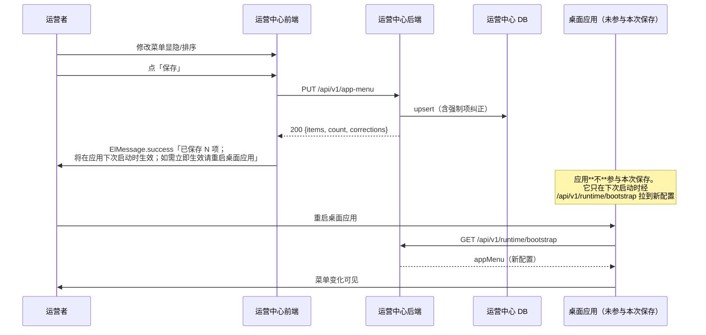

# PRD：运营中心「保存后提示需重启应用生效」

| 项 | 内容 |
|---|---|
| PRD 编号 | ops-center-restart-hint |
| 日期 | 2026-10-17 |
| 状态 | 待 CEO 签字 |
| 优先级 | P1（不影响功能正确性，影响运营者体验与信任） |
| 关联 | 前置：PR #3824（前端 base 子路径修复）；上游：`ops-center/deploy/nginx-ops.conf`、`apps/desktop/electron/services/ops-center-sync.js` |

---

## 1. 背景与问题

### 1.1 现象
运营者在运营中心修改「应用菜单」等运行时配置后，**桌面端应用界面不发生变化**。运营者的第一反应是「设置没保存」或「功能坏了」，于是反复保存、反复检查，甚至回滚自己的修改。

### 1.2 根因（已实测定位，非推测）
桌面端 `OpsCenterSync` **只在应用启动时同步一次**，之后没有任何定时同步：

```
ops-center-sync.js:748  async autoSyncOnStart() {
                              ...
  setTimeout(() => { this.syncNow() }, 3000)   ← 启动后 3 秒，仅此一次
                          }
```

全文件搜 `setInterval` / `INTERVAL` / `periodic` → **0 命中**。

`MpSidebar.vue:126-127` 的注释其实已写明这个设计：
> 此后由主进程广播的 `ops-center:runtime-updated` 触发重拉，运营侧改动在客户端**下次启动同步后**自动可见

即「需重启应用」是**当前实现的预期行为**，但**界面上没有任何地方告诉运营者这件事**。

### 1.3 为什么值得修
| 不修的代价 | 说明 |
|---|---|
| 运营者反复无效操作 | 反复保存、反复检查，浪费的时间远大于一句提示 |
| 误判为 bug 并回滚正确配置 | 2026-10-17 实际发生：用户因此怀疑「代码不生效」，触发了一整轮排查 |
| 信任损耗 | 「改了没反应」会让运营者不敢再用运营中心，宁愿改代码硬编码 |
| 阻塞其他真问题 | 把「连不上」误判成「代码不生效」，掩盖真正的部署故障（本次就是这样绕了远路） |

### 1.4 本次**不**做什么（范围收敛）
- **不加定时同步/轮询**。文章作者与仓内注释都指出：单站点场景加轮询是过度设计，且会带来备份、升级、权限三份额外维护面。
- **不加快捷同步入口**。`ops-center-sync-autosync-guard.js:30-37` 明确「运营同步对用户透明：配置卡片已隐藏」，加按钮破坏该契约。
- **不改广播机制**。`ops-center:runtime-updated` 保留，它解决的是「启动那次同步晚于侧边栏首帧」的场景。

---

## 2. 目标与非目标

### 2.1 目标
运营者在运营中心**保存运行时配置成功后，立即看到一句诚实的提示**，明确告知：
1. 保存已成功（不是保存失败）；
2. 何时在应用端生效（下次启动应用时）；
3. 如何让它立刻生效（重启应用）。

### 2.2 非目标
- 不实现即时生效（那需要长连接/轮询，属另一议题）；
- 不改动桌面端同步逻辑；
- 不新增任何后端接口；
- **不要求本轮覆盖全部下发页面**（2026-10-17 由 QM-6 评审 i1/i2 补充）。
  本轮只接 **AppMenu（应用菜单）一页**，把它当作契约验证的样板：文案单一真源、
  纯函数装配、测试与变异反证全部在这一页上落地。§4.1 登记表其余 5 页
  （Announcements / ContentPolicy / FeatureFlags / Parameters / EnvView）
  **属后续增量工作，不在本轮范围**。

  > 为什么允许这样收窄：本轮要验证的是「提示契约能否被机器守住」这一件事。
  > 一页做透（含 17 条变异反证）比六页各写一遍更能证明契约可守；
  > 而六页齐上会让 delta 膨胀、把「契约是否成立」和「覆盖是否完整」两个问题混在一起，
  > 任一出问题都难以定位。**这是范围收敛，不是遗漏** —— 判据是 §4.1 登记表本身仍然完整保留，
  > 后续会话可按它逐页推进。

### 2.3 成功判据
| # | 判据 | 度量方式 |
|---|---|---|
| G1 | 所有运行时配置页保存成功后，提示包含「重启」与「生效」两个语义 | 单测断言提示文案 |
| G2 | 提示在成功路径**必现**，失败路径**不出现** | 单测分别断言 success/error 两条路径 |
| G3 | 提示不遮挡保存结果本身（项数、纠正列表仍可见） | 单测断言 message 内容仍含项数 |
| G4 | 无新增后端接口、无新增依赖 | `git diff` 文件清单 |

---

## 3. 用户故事

**US-1**（运营者）：我在运营中心改了应用菜单的显隐，点保存。我想立刻知道「这改动什么时候会在应用里看到」，而不是靠猜。

**US-2**（运营者）：我刚保存完，想让它马上生效。我想知道要做的是什么动作（重启应用），以及重启的是哪个程序（桌面应用，不是运营中心）。

**US-3**（运营者）：我保存失败了。我不希望看到「已保存，重启后生效」这种误导性提示。

---

## 4. 功能逻辑

### 4.1 触发范围（哪些页面要加提示）

**判据：该页保存的配置是否会经 `/api/v1/runtime/bootstrap` 下发到桌面端。**

后端 `runtime_service.py:410` 的 bootstrap payload 包含：
```
announcements / update_policy / content_policy / appMenu / feature_flags /
pipelineOptions / rewrite_hard_constraints / rewrite_ai_taste_map
```

据此，**纳入范围**的页面：

| 页面 | 下发字段 | 说明 |
|---|---|---|
| `AppMenu.vue` | `appMenu` | 本次问题起源，**P0** |
| `Announcements.vue` | `announcements` | 运营公告 |
| `ContentPolicy.vue` | `content_policy` | 内容安全策略（含敏感词库） |
| `FeatureFlags.vue` | `feature_flags` | 功能开关 |
| `Parameters.vue` | `pipelineOptions` | 流水线选项 |
| `EnvView.vue` | （经 config 下发） | 环境配置 |

**不纳入**（仅存运营中心本地 DB，不下发应用端）：`ContentTemplates`、`KeywordWatchlist`、`Licenses`、`MemberGrants`、`ModelKeys`、`ModelPresets`、`AuditLog`、`RedeemCodes` 等。

> 这条边界是**契约级**的：给不下发的页面加「重启生效」提示是**错误提示**（误导运营者去做无用的重启）。因此必须由一份显式登记表决定，不得按「看起来像设置页」猜。

### 4.2 提示文案（单一真源）

文案抽成**一个模块级常量**，禁止各页面各写一遍（各写一遍就会漂移，且无法统一测试）：

```js
// ops-center/frontend/src/constants/runtime-delivery.js
export const RESTART_HINT_WHEN = '将在应用下次启动时生效'
export const RESTART_HINT_HOW  = '如需立即生效请重启桌面应用'
export const RESTART_HINT = RESTART_HINT_WHEN + '；' + RESTART_HINT_HOW
```

**为什么拆两段（2026-10-17 由变异 MR2/MR3 实证）**：

文案不是「一整句话」，而是**两个独立语义**，必须各自可被断言：

| 段 | 语义 | 若与另一段合并会怎样 |
|---|---|---|
| `RESTART_HINT_WHEN` | 何时生效（应用下次启动） | 删掉它的「生效」后，`HOW` 段仍含「生效」⇒ 子串断言**抓不到**（MR2 实测：变异后红 0） |
| `RESTART_HINT_HOW` | 如何让它立刻生效（重启桌面应用） | 把「重启」换成「查看」得到「如需立即查看请重启桌面应用」，仍含「重启」⇒ 子串断言照绿（MR3 实测：变异后红 0） |

**因此测试对两段都用精确等值断言**（`toBe`），不用 `toMatch(/重启/)`：
文案是契约的一部分，改一个字都要显式过测试。

**为什么必须抽常量**：本次要改 6 个页面。若各写一遍，①文案会漂移；②单测要写 6 条重复断言；③将来改口径（比如加了定时同步）要改 6 处。

### 4.3 交互逻辑

**成功路径**：
```
用户点保存 → API 200 → 
  ├─ 有 corrections（强制项被纠正）
  │    → ElMessage.warning('已保存。以下核心入口被系统纠正为「显示在一级导航」：xxx' + '；' + RESTART_HINT)
  └─ 无 corrections
       → ElMessage.success('已保存 N 项；' + RESTART_HINT)
```

**失败路径**：`ElMessage.error(e.response?.data?.detail || '保存失败')` —— **不加**提示。

**恢复默认（reset）路径**：与保存同口径，也加提示（它同样改下发配置）。

### 4.4 显示项与提示文字规格

| 场景 | 类型 | 文案 | 时长 |
|---|---|---|---|
| 保存成功（无纠正） | success | `已保存 N 项；已保存，将在应用下次启动时生效；如需立即生效请重启桌面应用` | 默认 3000ms → **改为 6000ms**（文案变长，3 秒读不完） |
| 保存成功（有纠正） | warning | `已保存。以下核心入口被系统纠正为「显示在一级导航」：xxx；已保存，将在应用下次启动时生效；如需立即生效请重启桌面应用` | 6000ms |
| 保存失败 | error | 原样保留，**不加**提示 | 默认 |
| 恢复默认成功 | success | `已恢复默认；` + RESTART_HINT | 6000ms |

**为什么时长要改**：Element Plus 的 `ElMessage` 默认 3000ms。新文案约 40 个汉字，按中文阅读速度（约 5 字/秒）需 8 秒。取 6000ms 是「多数人能读完」与「不长时间挡屏」的折中；这条判据写进测试，防止后人调回去。

---

## 5. 数据校验

| # | 校验 | 判据 | 失败处理 |
|---|---|---|---|
| V1 | 提示只在 HTTP 200 后出现 | 单测：mock reject 时断言 `ElMessage.success` **未被调用** | 测试红 |
| V2 | 提示不影响保存结果渲染 | 单测：断言 `items.value` 仍被 `result.items` 更新 | 测试红 |
| V3 | 提示不影响 `dirty` 复位 | 单测：断言 `dirty.value === false` | 测试红 |
| V4 | 提示不影响 corrections 展示 | 单测：有 corrections 时 warning 仍含 key 列表 | 测试红 |
| V5 | 文案唯一 | 单测：`grep` 全 src 目录，字面量 `重启桌面应用` 只出现在常量定义处 | 测试红 |
| V6 | 时长 ≥ 6000 | 单测：断言 `duration` 参数 | 测试红 |

**V5 的特殊性**：这是一条**结构锁**，用「同一字面量不得出现两次」防止后人绕过常量直接写。它必须允许常量定义处出现一次，因此判据是「出现次数 === 1」而非「=== 0」。

---

## 6. 流程



---

## 7. 测试方案

### 7.1 新增测试文件
`ops-center/frontend/tests/restart-hint.test.js`

### 7.2 用例
| # | 用例 | 断言 |
|---|---|---|
| T1 | 保存成功（无纠正）→ success 含项数 + RESTART_HINT | 两条子串都在 |
| T2 | 保存成功（有纠正）→ warning 含 key 列表 + RESTART_HINT | 两条子串都在 |
| T3 | 保存失败 → success **未**被调用，error 被调用 | 调用计数 |
| T4 | `duration` ≥ 6000 | 数值下界 |
| T5 | 字面量 `重启桌面应用` 全 src 只出现 1 次（V5 结构锁） | 计数 === 1 |
| T6 | reset 成功 → 同样含 RESTART_HINT | 子串 |

### 7.3 变异反证（每条都要让测试红）
| 变异 | 期望 |
|---|---|
| 去掉 RESTART_HINT 拼接 | T1/T2/T6 红 |
| 失败路径也加提示 | T3 红 |
| duration 调回 3000 | T4 红 |
| 在第二个页面直接写死字面量 | T5 红 |

---

## 8. 影响面与风险

| 风险 | 等级 | 缓解 |
|---|---|---|
| 提示太长挡屏 | 低 | 6000ms + 只在保存成功时出现 |
| 运营者仍不重启，问题未根治 | 中 | **如实记录为未闭合项**：本 PRD 只解决「告知」，不解决「即时生效」 |
| 漏改某个下发页面 | 中 | §4.1 登记表 + 新增页面时的 checklist |
| 误给不下发页面加提示 | 中 | §4.1 明确「不纳入」清单，代码评审逐项核 |

---

## 9. 遗留（不假装已闭合）

1. **未实现即时生效**。若将来运营者反馈「重启太麻烦」，需另起议题评估定时同步；届时要一并评估轮询间隔、失败退避、以及「改谁来守门」的部署层影响。
2. **桌面端无「立即同步」入口**是刻意设计（`ops-center-sync-autosync-guard.js` 注明对用户透明）。若该设计变更，本 PRD 的文案需同步改口径。
3. **运营中心本身未部署到生产**（2026-10-17 实测：服务器后端为 2026-07-01 版，`/api/v1/app-menu` 404）。本 PRD 的提示要在**部署完成后**才对运营者可见。

---

## 10. CEO 签字

- [ ] 已阅读并同意范围（§2.1 目标 / §2.2 非目标）
- [ ] 已阅读提示文案（§4.2）与显示规格（§4.4）
- [ ] 已阅读「不做什么」（§1.4）
- [ ] 同意遗留项（§9）
